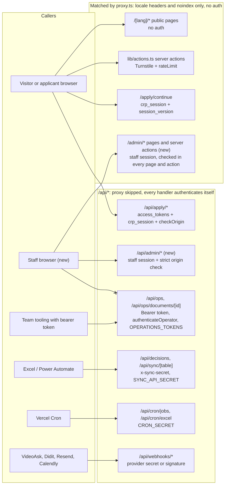
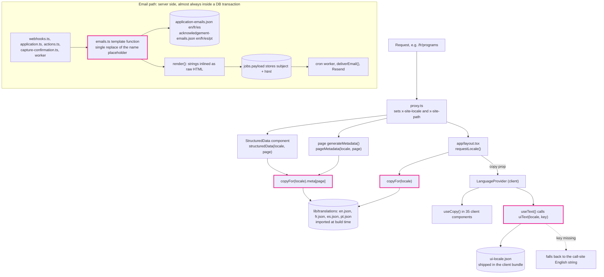

### Overview

The site is a Next 16.3.4 App Router app. It has one root layout (`app/layout.tsx`) and a locale-routing `proxy.ts` (Next 16's replacement for `middleware.ts`). Postgres is reached lazily through `getDb()` in `lib/db/index.ts`. A job outbox is worked by a Vercel cron that runs once a minute. Four facts shape any `/admin` work.

1. **There is no staff identity.** "Staff" means whoever holds one of the bearer tokens whose hashes are listed in the `OPERATIONS_TOKENS` env var. `authenticateOperator()` maps a token to an opaque operator id string, and every valid token can do everything `/api/ops` offers. There is no user table, no role, and no browser session for staff. The only cookie session is the applicant's `crp_session`.
2. **All copy is bundled at build time.** Page copy, UI chrome, and both email catalogs are JSON files imported at module scope by `lib/messages.ts`, `lib/ui-text.ts`, and `lib/emails.ts`. Every reader is synchronous, and no public page render touches the database today. The request only picks a locale.
3. **The applicant model is one row with a status enum.** The pipeline is `applicants.status`, guarded by `TRANSITIONS` and `transition()` in `lib/lifecycle.ts`. The other tables a dashboard needs (`nominations`, `interest`, `waitlist`, `partner_inquiries`) are flat capture tables with little or no status.
4. **The visual system is tokens and repeated class strings.** Tailwind v4 tokens live in `app/globals.css`, and there is no component library. The nearest thing to an admin screen is the cream page with one 32px white card, used by `app/confirmation` and `app/apply/continue`.

So `/admin` needs new tables (staff users, sessions, sign-in tokens, copy overrides and history), a new cookie, and a page tree beside `app/[lang]` rather than inside it. It also needs a new copy read path that every copy consumer goes through. None of this requires changing the apply routes, the bearer routes, or the proxy. The risk is that several copy consumers sit inside the apply flow's database transactions and its client bundle.

**Corrections to the explorer reports.** The reports are mostly accurate. Where they disagree with the code, the code wins, and these corrections affect the design:

- **Bad `OPERATIONS_TOKENS` does not stop production from booting.** `operationsCredentials()` returns `[]` for any malformed entry, and `assertBackendConfig()` then throws. But that check runs on the first `getDb()` call in each process, not at boot. It also re-throws on every later call because `checked` is never set. The real effect is that every database-backed request fails until the env is fixed. That matters as soon as public copy reads the database.
- **`deliverEmail` is documented as worker-only.** The header of `lib/email.ts` says its callers are "the job worker, never a request handler". The existing applicant sign-in link (`requestResumeLink` in `lib/application.ts`) is only enqueued and waits up to a minute for the cron. Sending login mail inside the request, as the auth report suggests, would be a new pattern that breaks a written contract, not reuse of an existing one.
- **Email HTML trust is wider than "signoff only".** `render()` in `lib/emails.ts` inserts every catalog string into the HTML unescaped: paragraphs, button labels, tagline, and the rights line. Only applicant-supplied names go through `escapeHtml`. `signoff` is the only string that contains markup today, but every email string is treated as trusted HTML.
- **A CSRF helper already exists, and it is permissive.** `checkOrigin()` in `lib/request-origin.ts` is the codebase's CSRF primitive. It returns `"ok"` when a request has neither `Sec-Fetch-Site` nor `Origin`. That suits its current email-link POSTs but is too lenient for a cookie-authenticated admin mutation.
- **Migration 0012 already breaks the enum rule.** It adds the `under_review` enum value and then runs `UPDATE ... SET status = 'under_review'` in the same file. It also skips `IF NOT EXISTS`. It passes `tests/db.mjs` only because that harness autocommits each statement. The rule is still right; the test harness just won't catch a violation.
- **A React `cache()` around the merge is not enough by itself.** It removes duplicate reads within one request. It does not keep public pages off the database across requests, and `revalidateTag` has nothing to invalidate unless the merge sits in a tagged cross-request cache.
- **There are more hardcoded copy islands than the report lists.** `lib/confirmation-page.ts` (the switch-online confirm page) has four locales inline. In `lib/apply-skills.ts`, the English skill labels are the values stored in `applicants.skills` and checked by `isSkillLabel()`, so they are data, not editable copy.

### Key Concepts

**Operator.** A configured principal `{id, tokenHash}` in the `OPERATIONS_TOKENS` JSON array, minted by `scripts/create-operator.mjs`. The runbook uses emails as ids (`reviewer@example.com`), but nothing enforces that. `authenticateOperator(headers)` hashes the bearer token with SHA-256 and compares it in constant time with `secretOk()` from `lib/api-auth.ts`. The id is used only in attribution text.

**Actor.** The closed set in `lib/lifecycle.ts` (`applicant | videoask | identity | excel | ops | system`) written to `application_events.actor`. Ops actions record `actor: "ops"` and append the operator id to the `reason` text, for example `"... (by reviewer@example.com)"`. Adding staff roles doesn't require changing this.

**Applicant session.** The `crp_session` cookie holds `applicantId.version.exp.signature`, signed by HMAC with `APP_SECRET` under the `session:` prefix. It lasts 12 hours and is `httpOnly`, `sameSite=lax`, with path `/`. `verifySession()` checks the signature and expiry. Callers then compare `version` with `applicants.session_version`, which every new sign-in increments, so signing in again revokes older sessions. `APP_SECRET` also signs VideoAsk refs and Calendly refs and keys the rate-limit buckets. Rotating it affects all of them.

**Access token.** A hashed, purpose-scoped, expiring row in `access_tokens`, with purpose `resume` or `switch_online`. `consumeAccessToken()` is strictly single-use. `redeemAccessToken()` lets a link keep working until expiry so that mail scanners opening it first don't burn it. `applicant_id` is `NOT NULL` with a foreign key to `applicants`, which is the concrete reason staff sign-in tokens can't live in this table.

**Outbox.** Rows in `jobs` are inserted in the same transaction as the business write (`enqueue()` and `enqueueEmail()` in `lib/jobs.ts`). The worker claims them with `SKIP LOCKED`, retries with backoff, and parks a job as `failed` after 8 attempts. A job's `dedupe_key` is also sent as Resend's `Idempotency-Key`. `jobs.applicant_id` is nullable, so mail not tied to an applicant can use the queue.

**Catalog.** One of four bundled JSON sources:

| Catalog | Files | Locales | Shape |
|---|---|---|---|
| Page copy | `{en,fr,es,pt}.json` | en/fr/es/pt | 372 nested string leaves, including arrays |
| UI chrome | `ui-{locale}.json` | en/fr/es/pt | 114 flat keys; the key is the English source string |
| Acknowledgement emails | `acknowledgement-emails.json` | en/fr/es/pt | 13 keys |
| Application emails | `application-emails.json` | en/fr/es only | 32 keys |

All four live in `lib/translations/`.

**Public path.** One of the nine paths in `publicPaths` in `lib/locale.ts`. The proxy adds locale prefixes and allows indexing only for these. Any other path, including a future `/admin`, gets `X-Robots-Tag: noindex, nofollow` and a locale taken from a cookie.

**Design token.** A Tailwind v4 `@theme` variable in `app/globals.css`: seven colors, `--font-sans` bound to Outfit, the `desk` breakpoint at 900px, and two "blob" radii. The same file defines the `gradient-brand`, `eyebrow`, `text-outline`, and `no-scrollbar` utilities.

### How It Works

#### Request boundaries and auth

Every request other than API routes and static assets goes through `proxy()` in `proxy.ts`. Its matcher, `/((?!api(?:/|$)|_next/|.*\.).*)`, skips `/api/*`, `/_next/*`, and any path containing a dot. For each matched request it:

- strips a locale prefix and decides whether the rest is a public path;
- sets the `x-site-path` and `x-site-locale` request headers;
- 308-redirects unprefixed public GET requests to `/en/...`;
- adds the `noindex` header to everything non-public.

It does no authentication. `/admin` will be non-public: no redirect, a `noindex` header, and a locale from the `crp-locale` cookie. `/en/admin` falls through to `app/[lang]` and returns 404, because there is no `app/[lang]/admin`.

Authentication happens in each route handler, and each kind of route has its own credential:

- **Ops.** `/api/ops` and `/api/ops/documents/[id]` call `authenticateOperator()`. `/api/ops` GET returns the overview or one applicant's detail; the documents route streams private identity documents from Vercel Blob. `/api/ops` POST passes the operator id to `performAction()` in `lib/ops.ts`. That function has four actions: `retry_job`, `provision_identity`, `send_resume_link`, and `transition`, which goes through the lifecycle with an optional `expectedVersion` concurrency guard.
- **Excel sync.** `/api/decisions` and `/api/sync/[table]` compare the `x-sync-secret` header with `SYNC_API_SECRET`.
- **Cron.** `/api/cron/jobs` and `/api/cron/excel` check `CRON_SECRET`, sent as a bearer token or `x-cron-secret`.
- **Webhooks.** `/api/webhooks/*` verify each provider's secret or signature (a shared secret for VideoAsk, Svix for Resend, raw-body signatures for Didit and Calendly) and store events in `webhook_events`.
- **Applicant routes.** `/api/apply/resume`, `/api/apply/switch-online`, and `/api/apply/verify` use access tokens and `crp_session`. Their POST handlers gate on `checkOrigin()`.
- **Applicant page.** `app/apply/continue/page.tsx` is the only page that authenticates. It verifies `crp_session`, loads the applicant, and checks `emailVerifiedAt` and `sessionVersion`.
- **Public forms.** Submissions are server actions in `lib/actions.ts`, protected by Turnstile and the Postgres-backed `rateLimit()`.

The crossed edge is deliberate. A staff session is a new credential that runs alongside the others. It should be its own cookie and authorize only `/admin` pages, `/admin` server actions, and new `/api/admin/*` handlers. The bearer routes stay bearer, and a staff cookie must never start authorizing `/api/ops`.

Because the proxy skips `/api/*`, the `/api/admin` handlers must check the session themselves. A check in `app/admin/layout.tsx` alone also isn't enough, for two reasons. App Router layouts don't re-run on every client-side navigation. And server actions are POST endpoints that anyone can call directly. Each page and each action must do the check, ideally through a single function they all call before reading data.

**Sign-in mail: two pieces to reuse and one conflict.** `deliverEmail(input, idempotencyKey)` in `lib/email.ts` makes a single Resend call with a 20-second timeout and marks 429 and 5xx responses as retryable. When `RESEND_API_KEY` or `RESEND_FROM` is unset it returns `{ ok: true, skipped: true }`, so in development a login email "succeeds" and nobody ever sees the link.

The applicant equivalent, `requestResumeLink()`, only enqueues a job. In the worker, `prepareResumeEmail()` (`lib/resume-delivery.ts`) mints the token at delivery, saves the rendered HTML into `jobs.payload`, and pushes back the unused token's expiry on each retry. That guarantees one message per key, but the applicant waits up to a minute for the cron. There are three options, and the design should pick one on purpose:

- accept that latency;
- enqueue, then immediately claim and run that one job inside the request (`claimJobs`, `runClaimedJob`, and `settle` in `lib/jobs.ts` can be called separately);
- call `deliverEmail` from the request handler and rewrite the comment that forbids it.

**Reusable primitives.** For rate limiting there's `rateLimit(scope, identifier, limit, seconds)` with `clientIp()` in `lib/rate-limit.ts`; keys are HMAC'd and shared across instances. For CSRF, `/api/admin` mutations need a stricter version of `checkOrigin()`. Server actions get Next's built-in Origin/Host check.

**Bootstrap has no precedent.** There is no user table to seed. The natural fit is an env allowlist checked when a magic link is first redeemed. Don't add that variable to `assertBackendConfig()`'s required list, though. In production, a missing admin setting would then break every database-backed request, including the apply flow.

#### The copy read path today

The four outlined nodes are where a published override has to enter. Missing any one of them leaves part of the site on the file copy.

**Page copy.** `copyFor(locale)` in `lib/messages.ts` returns `messages[locale]`, the imported JSON object. Within one request it can be called from three server places:

- the root layout, which passes `copyFor(locale)` into `LanguageProvider` as the `copy` prop;
- `pageMetadata()` and `structuredData()` in `lib/seo.ts`, which read `.meta[page]` through each page's `generateMetadata` and `<StructuredData>`;
- the partner reach-out page's `generateMetadata`, which reads a form title.

Client components get page copy only through `useCopy()` (35 files), which reads the provider prop. No client component indexes `messages` directly. So changing what the root layout passes updates every page string rendered by client components. Titles, descriptions, and JSON-LD come from separate `copyFor` calls, though, and need the same change.

Four components (`Footer`, `LanguageDropdown`, `LanguageSwitch`, `AgeSelectionLayout`) import the `t()` interpolator from `lib/messages.ts`. As a side effect, that pulls all four page catalogs into the client bundle. `t()` replaces each `{word}` token and turns a missing variable into `""`. The only placeholders in page copy are `{language}` and `{year}`.

**UI chrome.** `lib/ui-text.ts` is a `"use client"` module. `uiText(locale, text)` returns `uiMessages[locale][text] ?? text`, and `useText()` binds it to the provider's locale. The map is bundled into the client and no server value reaches it. A server-side override map therefore changes nothing until it is passed down, for example next to `copy` through `LanguageProvider`, and `useText()` reads it.

The fallback is the call-site string, not `ui-en.json`. That matters because two English values differ from their keys: `"Only program"` displays as `"Online program"`, and `"Close / Fermer"` as `"Close"`.

`useText()` is used throughout the apply flow (`components/apply/*`, including `Toast`, `FormShell`, `DateField`, and `CountryDropdown`), in the nominate flow, and in the cookie banner. UI chrome is not "public pages only".

**Emails.** `lib/emails.ts` imports both email catalogs at module scope. Each template function is synchronous: `applicationEmail`, `resumeEmail`, `identityEmail`, `receivedEmail`, `identityRetryEmail`, `decisionEmail`, and the four acknowledgements. Each one:

1. picks a catalog entry;
2. fills `{name}` or `{nominee}` with a single `String.replace`, so only the first occurrence is filled;
3. calls `render()`, which inlines every string into a table-layout HTML shell with the brand colors hard-coded as constants.

Acknowledgements fall back to English through `parseLocale`. Application emails are typed `ApplicationLocale` (en/fr/es), so there is no Portuguese path.

Almost every call site runs inside a database transaction, often one that has locked the applicant row:

- `lib/webhooks.ts`: decision and received emails;
- `lib/application.ts`: the application subject, received, and identity retry;
- `lib/capture-confirmation.ts` and `lib/actions.ts`: acknowledgements;
- `app/api/apply/switch-online/route.ts`;
- `prepareResumeEmail()` in the worker.

Acknowledgement and decision emails are rendered when they are enqueued. Application and resume emails are rendered on the first delivery attempt. Either way, the rendered subject and HTML are saved in `jobs.payload`, and every retry sends those exact bytes. The one exception is the identity fallback email in `lib/worker.ts`, which is re-rendered on every attempt. So an edit reaches only mail rendered after it, never mail already in the queue.

**What a database-backed override has to do.** It follows from the paths above:

- Use one loader per catalog with a tagged cross-request cache, so public pages don't query on every request.
- Wrap that loader in React `cache()` to collapse the up to three reads per request.
- Fall back to the JSON object without caching the fallback. With `unstable_cache`, throw inside the cached function and catch outside it.
- Call the loader from every server read site: the layout, `lib/seo.ts`, the reach-out metadata, and the email templates.
- Pass the UI override map down to the client.

`tests/seo.test.mjs` calls `copyFor`, `pageMetadata`, `structuredData`, and the email functions synchronously through the `tests/helpers.mjs` loader, so making them async is a visible change. The smaller change is to keep them pure, take overrides as an explicit argument, and do the async loading at the edges.

Nothing in the repo uses `unstable_cache`, `revalidateTag`, or `"use cache"` today. `next.config.ts` doesn't enable `cacheComponents`, which `"use cache"` requires, and turning it on changes rendering for every route. `node_modules` isn't installed, so I couldn't confirm the Next 16 tag API (`revalidateTag`'s cache-profile argument, `updateTag` for server actions) against the installed version.

#### The applicant data model and what a dashboard reads

`applicants` in `lib/db/schema.ts` holds identity, profile, pipeline state, and the team-owned decision columns synced back from Excel. `status` is the `applicant_status` enum. In storage order, its values are `submitted, round1_complete, accepted, rejected, interview_yes, interview_no, docs_submitted, onboarding, online, ineligible, id_verified, id_failed, under_review, online_offered`. Later values were appended to keep the existing order.

The real flow is the comment above `TRANSITIONS`:

1. `submitted` to `round1_complete`.
2. In-person applicants pass the identity check: `id_verified` or `id_failed`.
3. `under_review`.
4. A decision: `accepted`, `rejected`, or `online_offered`.
5. From `accepted`, `interview_yes`, then `onboarding`, which can switch back and forth with `online`.

`docs_submitted` has no inbound transition, and `interview_no` is reachable only from `accepted`. A later review pass is tracked in `review_cycle`; there is no rounds table.

`version` is the optimistic-concurrency counter. Every write through `transition()` or `updateApplicant()` increments it, and both also append to the sync feed through `recordChange()`, which the Excel mirror and `/api/sync` consume. The other enums are:

- `identity_status`: pending, verified, failed, review;
- `track`: in_person, online;
- `app_language`: en, fr, es;
- `age_group`, `review_decision`, and `interview_outcome`.

The other four tables are simpler:

- **`nominations`** has a `nomination_status` enum (new, invited, applied, declined) and a unique nominator/nominee pair. The app only ever writes `new`.
- **`waitlist`** has `waitlist_status` (subscribed, unsubscribed). The app only ever writes `subscribed`.
- **`interest`** has no status.
- **`partner_inquiries`** has no status and no unique key. The sync feed calls it `partners`.

None of the four stores a locale. `updated_at` is set by Drizzle's `$onUpdate`, not a database trigger, so a row inserted once keeps its insert time.

`overview()` in `lib/ops.ts` is the only existing read model. It returns counts by status plus seven bounded queues, oldest first: awaiting identity, identity review, failed emails, failed jobs, missing callbacks, stalled reviews, and unprocessed webhooks. It never reads the other four tables, and its `counts` object omits statuses that have zero rows.

Its queues return full `jobs` and `webhook_events` rows, payloads included. `applicantDetail()` returns full applicant rows, including `identity_link`. That's acceptable behind a bearer token the team holds, but not as the data source for a "read-only" role. A dashboard should run its own narrow queries (counts and listing columns). It should also respect `getDb()`'s 5-connection pool, which it shares with the apply flow on the same instance.

#### Migrations and tests

`drizzle/meta/_journal.json` lists migrations 0000 through 0013. Snapshots exist only for 0000–0003, so `drizzle-kit generate` would diff against an outdated model. Production applies migrations with `npm run db:migrate` (per `BACKEND_SECURITY.md`).

Drizzle's migrator only applies a file whose journal `when` is greater than the timestamp of the last migration applied. 0013's `when` is `1792660000000`, so a hand-written 0014 with a smaller value is skipped without any error. As far as I know, the migrator also runs all pending files in one transaction (`node_modules` isn't installed, so I couldn't confirm this for the installed version). That is why a new enum value can't be used in the same migration run.

`tests/db.mjs` starts an embedded Postgres, splits each journal file on `--> statement-breakpoint`, and runs the statements one at a time with autocommit. New tables exist in tests only if the journal lists them, and the harness can't catch failures that only happen inside a transaction.

For internal closed sets on operational tables, the codebase stores `text` and types it with a TypeScript union: `jobs.kind`, `jobs.status`, and `access_tokens.purpose`. Postgres enums are reserved for the business sets mirrored to Excel. That precedent suits a role column that must later accept `member`.

#### The visual system

Tailwind v4, with no config file. The tokens are in the `@theme` block of `app/globals.css`:

| Token | Value |
|---|---|
| cream (body background) | `#f4f1ea` |
| ink | `#000000` |
| lime | `#d2de38` |
| magenta | `#ec268f` |
| orange | `#fa8d2e` |
| leaf | `#6dc06e` |
| pin | `#3dadff` |

`gradient-brand` is a `@utility`: a 100-degree gradient from magenta to orange. The desktop breakpoint is the custom `desk:` at 900px; components use `desk:` and `max-desk:`, never `md:` or `lg:`.

Fonts:

- **Outfit** (weights 400–700) is attached to `<html>` through `--font-outfit` and becomes `--font-sans`.
- **Trail Free** is a local display face, used only for large heading type on the Apply, About, and Waitlist sections.
- **Geist** is exported from `lib/fonts.ts`, but no component uses it. Emails reference Geist by name through Google Fonts, separately.

There is no shared Button or Card component. The recurring building blocks are class strings:

- **Pills:** `gradient-brand rounded-full`, uppercase semibold text.
- **Cards:** `rounded-[32px] bg-white` on cream.
- **Fields:** the `FIELD` constant in `components/apply/fieldStyles.ts` (`h-12 rounded-[40px] border border-black/12 bg-white`), with errors in `text-magenta`.

The 88px and 150px blob radii are sized for marketing pages. `app/confirmation/page.tsx` and `app/apply/continue/page.tsx` are the template for a page outside the locale tree: `grid min-h-dvh place-items-center bg-cream`, one white 32px card, and no Header or Footer. `Header`, `Footer`, and `LanguageDropdown` depend on the locale and the marketing nav, so they don't fit admin.

`/admin` inherits the root layout: `<html lang>` from the cookie locale, Outfit, and the `LanguageProvider`, `ConsentProvider` (cookie banner), and `PostHogProvider` wrappers. Opting out would mean restructuring the root layout that every public page depends on.

Index protection today is the root `metadata.robots` default plus the proxy's `X-Robots-Tag` header. `app/robots.ts` disallows `/api/`, `/apply/continue`, `/apply/complete`, and `/confirmation`, but not `/admin`. Public pages opt into indexing only through `pageMetadata()`, so admin pages must not call it.

### Where Things Live

**Staff and applicant credentials.**

- `lib/operations-auth.ts`: `operationsCredentials`, `authenticateOperator`.
- `lib/api-auth.ts`: `secretOk`, the constant-time compare.
- `lib/session.ts`: the applicant cookie.
- `lib/access.ts`: applicant access tokens.
- `lib/config.ts`: `appSecret`, `appUrl`, `assertBackendConfig`.
- `lib/request-origin.ts` and `lib/rate-limit.ts`: the CSRF and abuse primitives.
- `scripts/create-operator.mjs` and `BACKEND_SECURITY.md`: how operators are issued today.
- Route checks are at the top of each `app/api/**/route.ts`. Ops behavior is in `lib/ops.ts`.

**Mail.**

- `lib/email.ts`: transport.
- `lib/emails.ts`: templates and the HTML shell.
- `lib/jobs.ts`: outbox mechanics.
- `lib/worker.ts`: per-kind handlers, plus `tick()`, which also purges expired `access_tokens`, capture tokens, and rate-limit rows.
- `lib/resume-delivery.ts`: the mint-at-delivery pattern.
- `vercel.json`: cron schedules.

**Copy.**

- `lib/translations/*.json`, read by `lib/messages.ts` (server and client) and `lib/ui-text.ts` (client only).
- `components/LanguageProvider.tsx`: `useLanguage`, `useCopy`.
- `lib/seo.ts` and `components/StructuredData.tsx`: metadata and JSON-LD.
- `lib/locale.ts` and `lib/request-locale.ts`: locale resolution.
- Hardcoded copy islands: `app/apply/continue`, `app/apply/complete`, `app/confirmation`, `lib/confirmation-page.ts`, and the skill labels in `lib/apply-skills.ts`.
- `tests/seo.test.mjs`: the copy contract (key parity, placeholder parity, metadata, Spanish email escaping).

**Data.**

- `lib/db/schema.ts`: every table and enum.
- `lib/db/index.ts`: `getDb`, `closeDb`, and schema re-exports.
- `lib/lifecycle.ts`: `TRANSITIONS`, `transition`, `updateApplicant`, `lockApplicant`.
- `lib/sync-log.ts` and `lib/sync.ts`: the change feed.
- `drizzle/*.sql` and `drizzle/meta/_journal.json`: migrations.
- `tests/db.mjs` and `tests/helpers.mjs`: the test database and TypeScript loader.

**Visual and routing.**

- `app/globals.css`, `lib/fonts.ts`, and `components/apply/fieldStyles.ts`.
- `app/confirmation/page.tsx` and `app/apply/continue/page.tsx`: layout precedents.
- `app/layout.tsx`, `app/robots.ts`, `app/sitemap.ts`, and `proxy.ts`.

**New code.** It would go in `app/admin/**` (a sibling of `app/[lang]`), `app/api/admin/**`, and a hand-written `drizzle/0014_*.sql` with its journal entry.

### Gotchas

**Protecting the apply flow**

- **Email overrides can break apply transactions.** Templates run inside transactions that often hold the applicant row lock. If an override query on that same transaction fails, Postgres aborts the transaction, catching the JS error doesn't recover it, and the webhook, decision, or application step fails. Load email overrides before the transaction or on a separate connection, with a JSON fallback.
- **UI chrome edits reach the apply form directly.** Most `components/apply/*` labels, buttons, and toasts go through `useText()`, and `apply.*` page copy feeds `ApplyPage` and `AgeSelectionLayout`. "Don't break the apply flow" applies to the CMS, not only to the auth work.
- **Leave the lifecycle and ops alone.** Don't change `/api/ops`, the `"ops"` actor, or `TRANSITIONS`, including the unreachable `docs_submitted` and the `accepted`-only `interview_no`. Don't write to `applicants`, `jobs`, `webhook_events`, or the apply tables from admin code.
- **Keep the skill labels out of the CMS.** The English labels in `lib/apply-skills.ts` are stored values. Editing one would make existing `applicants.skills` entries fail `isSkillLabel()`.

**Protecting the public pages**

- **The database will now gate public copy.** Public renders don't touch the database today. `getDb()` throws on every call in production while any variable `assertBackendConfig` requires is missing or `OPERATIONS_TOKENS` is malformed; Vercel previews also run with `NODE_ENV=production`. Without a database URL it throws `DATABASE_URL is not set`. The pool's `connectionTimeoutMillis` is 10 seconds, so a slow database turns into a 10-second page load before the fallback applies. The copy loader needs its own short timeout or a keep-last-good-value strategy, and it must never cache the fallback.
- **`next build` runs without a database.** `getDb()` must stay lazy. Nothing in an auth library's setup may open a pool at import.
- **Never mutate the imported JSON objects.** Every request in the process shares the same module object.

**Auth surface**

- **Check auth in every page, action, and handler.** Layout-only checks are not enough (see "Request boundaries and auth"). Don't widen the proxy matcher, and don't paste an auth library's proxy or middleware wrapper over `proxy.ts`, which is the locale router. The explorer reports that better-auth and Auth.js both bring their own tables and an `/api/auth/*` handler, which is already outside the proxy matcher; I didn't re-verify that. Their documented setup generates tables with drizzle-kit, which conflicts with hand-writing 0014.
- **Dotted paths skip the proxy.** A URL like `/admin/copy/meta.home.title` bypasses the proxy entirely: no `noindex` header and no locale header. Keep dotted copy keys in query strings or request bodies, not path segments.
- **The staff cookie and `APP_SECRET`.** Keep staff sessions out of `crp_session`. If staff sessions are stored in the database, the cookie can be an opaque random id that is stored hashed, so no new `APP_SECRET` usage is needed. If anything new is signed with `APP_SECRET`, give it its own domain prefix, as `session:`, `videoask:`, and `calendly:` already have.
- **Expired staff tokens and sessions won't clean themselves up.** `purgeExpiredTokens()` only covers `access_tokens`, so the new tables need their own purge call in `tick()`.

**The admin surface**

- **PostHog wraps `/admin`.** `posthogOptions()` in `lib/analytics.ts` disables session recording and strips query strings and hashes from URLs. It doesn't set `autocapture`, so posthog-js's default (on) applies, and it doesn't remove path segments. A staff browser that accepted analytics cookies would send clicked element text, such as applicant names and emails, plus any `/admin/applicants/<uuid>` path. Keep the provider, but suppress capture on admin.
- **Reusing `overview()` would leak data from a "read-only" role.** Its `failedEmails` rows include `jobs.payload.html`, which holds live sign-in links for resume emails. `unprocessedWebhooks` includes raw provider payloads, and `applicantDetail()` includes `identity_link`. Select columns explicitly. Identity documents stay bearer-only through `/api/ops/documents/[id]`.
- **The editor's locale is a parameter, not the request locale.** On `/admin`, `requestLocale()` comes from the `crp-locale` cookie, which is only set with functional consent. And `LanguageProvider.setLocale()` on a non-public path changes `locale` but not `copy`.

**Copy-editing semantics**

- **Email strings are raw HTML.** Escape every override except the field that already carries markup (`signoff`'s ` `), or validate that one strictly. `{name}` is replaced only once, so a translation that uses it twice shows the literal token the second time.
- **Overrides bypass the placeholder test.** `tests/seo.test.mjs` checks key and placeholder parity against English, but only for the JSON files, so publishing must enforce the same rule. Page copy uses `{language}` and `{year}`; emails use `{name}` and `{nominee}`. `t()` silently renders an unknown token as `""`.
- **Empty string is a real value.** en has 4 empty leaves; fr, es, and pt have 5 each. Merge with `??` or explicit `undefined` checks, never truthiness. Merge per locale onto that locale's JSON. Unknown locales resolve to English through `parseLocale`.
- **Arrays are matched to code by position.** Examples are `footerHref(column, item)` in `lib/nav.ts`, testimonial photos, and support options. Override string leaves only, never the array shape.
- **Newlines in values are layout.** Seven components call `.split("\n")` on copy strings (for example `copy.apply.ages1926` in `AgeSelectionLayout`) to break lines. The editor has to keep `\n` intact, and a text field that normalizes whitespace would change the layout.
- **UI chrome falls back to the call-site key.** Not to `ui-en.json`.
- **Queued email keeps the old copy.** Jobs resend their stored bytes, so a published email edit affects only mail rendered afterwards.

**Migration 0014**

- Use a `when` greater than `1792660000000` and journal `idx: 14`.
- Don't run drizzle-kit, and don't edit 0000–0013.
- Use `IF NOT EXISTS` throughout.
- Don't add an enum value and use it in the same file. Better still, use `text` columns, which also avoids `ALTER TYPE` when `member` arrives.
- Remember that `tests/db.mjs` passing doesn't prove `npm run db:migrate` will succeed.
